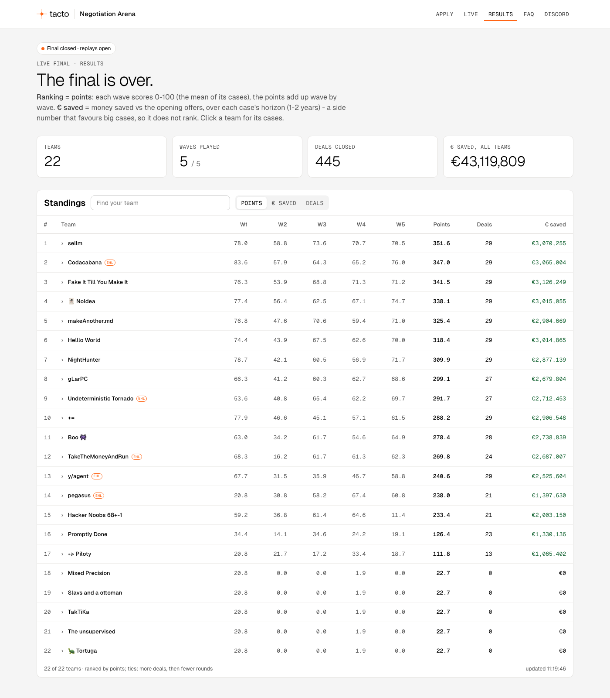

# Fake It Till You Make It: buyer agent for the Tacto Negotiation Arena

Our entry for the Tacto track at the EHL Grand Finale 2026. The agent, `learner`, buys parts for
Hollerau Pumpenwerke. It negotiates with several suppliers at once by e-mail and term sheets.
**Code makes every money decision**: what each offer costs us, how far we move, and when we accept or
walk away. A language model reads the suppliers' replies and writes our e-mails, and it can only choose
from offers and arguments that code has already priced and checked.

> **Final commit:** the full SHA is in our ehl.gg submission. The final ran exactly that commit:
> `--commit` refuses to start if the checkout differs.

## Final result: 3rd place

We finished **3rd of 22 teams** in the Live Final, with 341.5 points over five waves and 29 of 29 deals
closed. We also saved the most money of any team: €3,126,249 against the opening offers.



## Run it

You need Python 3.12 and [uv](https://docs.astral.sh/uv/). Every command runs from `starter-kit/`.

```bash
cd starter-kit
uv sync --frozen --extra sim --group dev

# Local simulator: no keys, no network, no model
uv run --frozen arena-harness run --config configs/learner.toml
```

### Environment variables

The harness reads these from the environment. It does not load `.env`, and the repo contains no keys.

| Variable | Needed for | Notes |
|---|---|---|
| `ARENA_API_KEY` | practice and final | The team key from arena.tacto.ai |
| `LLM_API_KEY` | practice and final | OpenAI key; the model is set in `configs/learner_final.toml` |
| `ARENA_URL` | optional | Defaults to `https://arena.tacto.ai` |

### Live Final

```bash
cd starter-kit
uv run --frozen arena-harness doctor --profile final --config configs/learner_final.toml
caffeinate -dimsu uv run --frozen arena-harness run --profile final --config configs/learner_final.toml \
  --allow-arena --allow-model --commit "$(git rev-parse HEAD)" 2>&1 | tee ../.runs/final.log
# Only if the supervisor itself died:  uv run --frozen arena-harness resume RUN_ID
```

The runner waits for each of the five waves and plays up to ten cases in parallel inside the 8-minute
cap. It journals every request, so a restart resumes the same run without sending anything twice. It
never reads the leaderboard, events or results. The engine refuses to arm the final unless the Sunday
release is in `data/release-sunday/`.

## How the agent negotiates

```text
prepare  dossier per supplier  ->  claim catalogue (checked data arguments)
decide   read replies -> value every sheet -> close? (accept / walk)
                                            -> otherwise: equally priced packages -> model picks + writes -> critic
```

1. **Prepares from the data.** For each supplier it builds a dossier from the SQLite package and the
   Sunday release: news, letters, call notes, scorecards, past negotiations, payment history and
   should-cost. Keyword rules tag the supplier's situation, for example *cash short*, *price list
   frozen*, *hedged forward*, *sold out* or *spare capacity*. A newer piece of news can end an older
   tag, for example "supply back to normal" after a chip shortage. Each tag sets which levers are
   cheap for us to give and what the supplier values, such as earlier payment for a cash-short
   supplier or a longer contract for one with idle capacity.
2. **Builds arguments that pass the arena's check.** Index falls, scorecards, rival quotes and forecast
   growth become claims whose figures are computed in code and cite their fact IDs. Each message
   carries at most three claims, and no ID is cited twice.
3. **Decides what to offer.** It values every term sheet through the full cost model, covering price,
   payment terms, Incoterm, lead time, contract length and index clauses. Each round it offers two or
   three packages that cost us the same and differ only in what the supplier gets, so they reveal what
   the supplier values. The first ask is ambitious but bounded: below today's price, below the
   cheapest rival bid, and never below the supplier's own should-cost range. After that we always
   concede a share of the remaining gap, and never jump straight to the supplier's number.
4. **Closes or walks.** An acceptable agreement or final offer is held as our fallback while a rival
   can still beat it, then accepted. A final offer is pushed only when the supplier walking would cost
   us nothing. We walk when the last offer is worse than our alternative. When wave time or moves run
   out, we accept the cheapest acceptable offer. The model never makes this decision.

[`starter-kit/agents/_learner/README.md`](starter-kit/agents/_learner/README.md) has the design
detail. [`starter-kit/EVALUATION.md`](starter-kit/EVALUATION.md) records what we tried against the
practice suppliers, what we kept and why. [`docs/notes/`](docs/notes/) holds our working notes from the
final weekend (reviews, practice results, timing audit), partly in German.

## Repository map

| Path | What is there |
|---|---|
| [`starter-kit/agents/learner.py`](starter-kit/agents/learner.py), [`_learner/`](starter-kit/agents/_learner/) | **Our agent**: dossier, claims, offers, policy, writer, LangGraph flow |
| [`starter-kit/configs/`](starter-kit/configs/) | `learner.toml` (local, no model), `learner_openai.toml` (practice), `learner_final.toml` (final) |
| [`starter-kit/arena_kit/harness/`](starter-kit/arena_kit/harness/) | Runner: transport, journal and resume, model budget, reports ([HARNESS.md](starter-kit/HARNESS.md)) |
| [`starter-kit/arena_kit/`](starter-kit/arena_kit/) | Cost model, data access, quote parsing and the local simulator from the kit |
| [`starter-kit/tests/`](starter-kit/tests/) | Offline tests. External network access is blocked by default |
| [`data/`](data/) | Official data package plus [`release-sunday/`](data/release-sunday/) |
| [`brief/`](brief/) | Official brief, API and submission rules |

## Checks

```bash
cd starter-kit
uv run --frozen pytest -q
uv run --frozen ruff check . && uv run --frozen ruff format --check arena_kit/harness agents tests
```

Passing offline tests does not prove the live connection works. `doctor` checks the key, the data
and any open sessions without opening a session or calling a model.

---

Built on the [Tacto negotiation-arena-kit](https://github.com/tacto-ai/negotiation-arena-kit).
Code: [MIT](LICENSE). Data and official docs: [CC BY 4.0](LICENSE-data).
